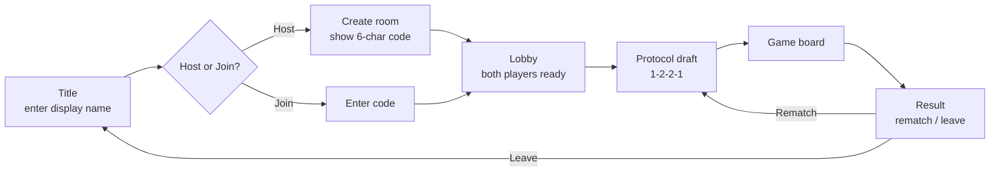
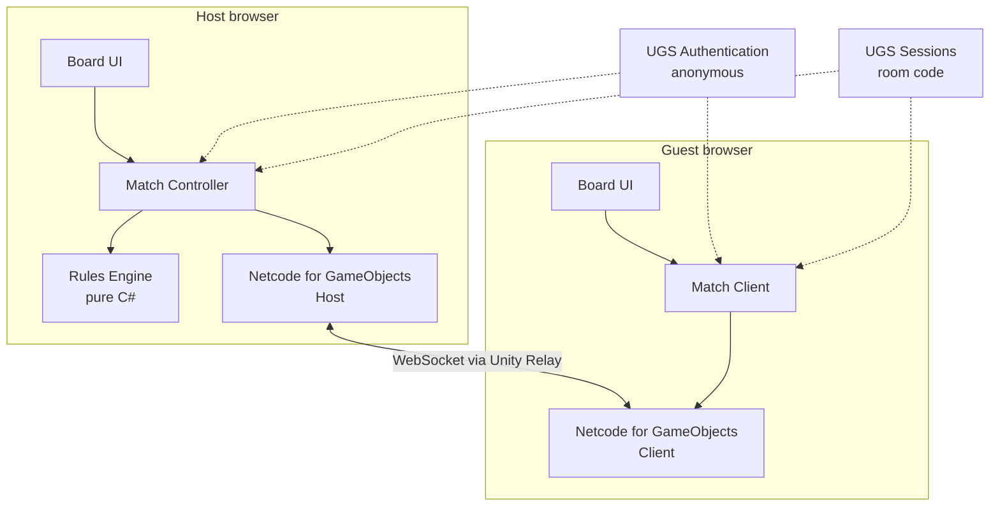

# Compile Online — Design Document

| | |
|---|---|
| **Status** | Draft v0.1 (2026-10-11) |
| **Engine** | Unity 6 (WebGL build) |
| **Players** | 2, online, private matches |
| **Rules source** | [`official/rules.md`](official/rules.md) (rulesheet + Compile Codex, 16 Dec 2024) |
| **Board reference** | [`board-setup.html`](board-setup.html) |

## 1. Overview

A browser-playable version of the card game **Compile**. Two players meet with a room code, draft Protocols, and play a full game against each other in real time. The game enforces every rule, including Control and card effects, so players never have to referee.

### Goals

1. Play a full, rules-correct game of Compile between two browsers.
2. Join a friend with a short room code. No installs, no accounts.
3. Support every Protocol that has art in `resources/img/cards` (15 Protocols).
4. Make hidden information safe enough for friendly play, and keep the rules engine portable so it can move to a dedicated server later.

### Non-goals (first release)

- Public matchmaking, ranked play, or stats.
- Accounts, friends lists, or chat.
- AI opponent (the engine design keeps this possible later).
- Phones. Below the minimum screen size the game shows a "screen too small" message instead of a cramped board (see [Supported screens](#supported-screens)).
- The beginner "no Control" variant. Control is always on.

## 2. Decisions So Far

| Topic | Decision | Why |
|---|---|---|
| Finding a match | Private room codes | Simple, cheap, fits a two-friend game. |
| Backend | Unity Gaming Services: **Authentication** (anonymous), **Multiplayer Services Sessions** (room codes), **Relay** (connection) + **Netcode for GameObjects** | No servers to run. Relay supports WebSockets, which WebGL requires. Free tier covers a hobby project. |
| Authority | **Host-authoritative.** The player who creates the room runs the rules engine; the guest sends moves. | Follows from the UGS choice. See [Hidden information](#hidden-information-and-trust) for the cost. |
| Card scope | All 15 Protocols in `resources/img/cards` | Main Set 1 (12) plus Apathy, Hate, and Love. |
| Identity | Guest only: anonymous sign-in plus a display name | No account system to build or secure. |
| Platforms | Desktop browsers and large tablets (touch). No phones. | Tablets are big enough for the board; phones aren't. |
| Presentation | A tabletop: `PlayMat.jpg` on a sci-fi desk, menus as panels lying on the desk, one camera moving between shots. | Feels like playing the physical game; one framing system handles wide and tall screens. |
| UI system | uGUI (world-space canvases on the table, a screen-space HUD), built from code with a shared `Theme`. | Mature, works in WebGL and with touch; code-built UI keeps every screen consistent. |

## 3. Player Experience

### Screen flow



### Screens

| Screen | Contents |
|---|---|
| **Title** | Display name field (saved locally), Host and Join buttons, link to the rules. |
| **Host / Join** | Host sees the room code with a copy button and "Waiting for opponent…". Join has a code field with validation and clear error messages ("Room not found", "Room is full"). |
| **Lobby** | Both names, ready toggles. Host picks who drafts first: **random** (default) or host/guest. The rulebook's "youngest player" rule becomes a choice or a coin flip. |
| **Draft** | Played on the mat: all 15 Protocol cards (Loading side) are spread over the local player's lanes. A status bar shows whose pick it is and how many remain (1-2-2-1). Each pick glides into its owner's next Protocol slot (left → middle → right), and the slot it will fill pulses. |
| **Game** | The board (see below). |
| **Result** | A panel resting on the local lanes with the winner, Rematch, and Leave. The winner's Protocols flip to their Compiled side. Rematch keeps the same room and starts a new draft; the loser drafts first. |
| **Rules** | A condensed, scrollable rules summary (`Assets/Compile/Data/rules-summary.txt`). |

### Tabletop presentation

The game is presented as a physical table rather than flat screens:

- **The desk:** a dark sci-fi console surface (`TableSurface.shader`): faint world-space grid, a soft violet glow under the mat, and a contact shadow at the mat's edge.
- **The mat:** `PlayMat.jpg` (1398 × 3788; centered in a 2048 × 4096 texture in the project) is one two-player mat lying at the table origin, the local player's half toward the camera. Its measured slots and lanes are in `MatLayout.cs`.
- **Menus lie on the desk:** each menu (Title, Host, Join, Lobby, Rules) is a world-space panel resting on the desk just past the near edge of the mat, with a drop shadow. Panels settle onto the desk when they appear and lift away when they leave.
- **One camera, several shots:** a `CameraRig` moves between framings (menu panel, draft, board, result). Each shot names a rectangle of the table and a tilt; the rig solves for the camera distance that keeps that rectangle on screen at the current aspect ratio, so wide and tall screens both work without separate layouts for menus.
- **Screen-space HUD:** only things that aren't objects on the table (status, short messages, hover details, debug actions) use a screen-space overlay.

### Game board layout

Matches the physical table:

- `PlayMat.jpg` with the local player's lanes and Protocols in front, the opponent's half beyond, seen from a tilted seat (40°) over the local half. The framing reaches from just past the near edge of the mat to the opponent's first card in each lane.
- **On the table:** both players' stacks cascade away from their Protocols, each covered card showing its value and top command (a stack squeezes down when long, then runs off the mat toward its owner). Lines are shared columns: the opponent's stack in a line sits in the same column, mirrored top to bottom.
- **Line totals** sit on the center line between the Protocol rows, opponent above and local below, and turn green (you) or red (opponent) when that side can compile.
- **Hand (screen-space):** fanned along the bottom edge; resting cards sit partly below the screen (value and top command visible) and rise when hovered or selected. The opponent's hand is a count.
- **Deck, trash, and Control:** on wide screens they lie on the desk beside the mat (Control slides toward whoever holds it); on tall screens the HUD strips show the counts instead. Trashes are public: tap to browse.
- A phase bar mirroring the board's banner: `START › CONTROL › COMPILE › ACTION › CACHE › END`, with the current step lit and whose turn it is.
- The board renders from a `PlayerView` (`Compile.Engine.Views`), so the same code will draw the engine's and the network's views.

### Supported screens

The game page fills the browser window and re-lays itself out on resize and rotation.

| Target | Examples | Viewport (CSS px) | Support |
|---|---|---|---|
| Desktop / laptop | Any modern Chrome, Edge, Firefox, Safari | 1280 × 720 and up | Primary |
| Large tablet, landscape | iPad (10th gen) 1180 × 820, iPad Air / Pro 11" 1194 × 834, iPad Pro 13" 1366 × 1024, Galaxy Tab S 1280 × 800 | Short side ≥ 768 | Supported |
| Large tablet, portrait | Same devices rotated | Short side ≥ 768 | Supported (tall layout) |
| Phones, small tablets | Anything with a short side < 768 | — | "Screen too small" message |

**Two layouts, picked by aspect ratio:**

| Layout | When | Arrangement |
|---|---|---|
| **Wide** | Width ≥ height | The mat in the center with desk on both sides. Deck, trash, and Control beside the mat. Event log in a side panel that can collapse. |
| **Tall** | Height > width | The mat fills the width. Deck, trash, and counts sit in a strip above (opponent) and below (you) the mat. Event log becomes a drawer. |

Rules for both layouts:

- Table objects are framed by the camera rig, so they keep their proportions at any aspect ratio. The screen-space HUD uses a Canvas Scaler (*Scale With Screen Size*, 1920 × 1080, match 0.5).
- Card text is too small to read at board size on a tablet, so the zoomed card view is the main way to read cards, not a convenience.
- Every touch target is at least 44 × 44 pt.
- Nothing relies on hover, right-click, or keyboard modifiers. Those are shortcuts only; every action has an on-screen control.

### Interactions

Every action works with a mouse and with touch.

| Action | Mouse | Touch |
|---|---|---|
| Play a card | Drag from hand to a line, or click the card then click a line. | Drag, or tap the card then tap a line. |
| Choose orientation | On-screen **Face-up / Face-down** toggle on the selected card. Right-click flips it as a shortcut. | The same on-screen toggle. |
| Show legal moves | Legal lines highlight and illegal ones dim as soon as a card is selected. | Same. |
| Refresh | Button, enabled only when legal (fewer than 5 cards in hand). | Same. |
| Read a card | Hover shows a large view; click the magnifier for a pinned view. Covered cards can be inspected too. | Long-press shows the large view until you lift your finger; the magnifier pins it. |
| Answer a choice | The engine asks for choices ("Choose 1 card to flip", "Discard 1 card", "You may shift…"). Valid targets glow. Optional choices get a **Skip** button. | Same, with tap. |
| Rearrange Protocols (Control) | Drag Protocols into a new order on either side, then **Confirm** or **Don't rearrange**. Confirm is disabled until the order is different. | Drag, or tap two Protocols to swap them. |
| Clear Cache | Select cards to discard until you hold 5. | Same, with tap. |
| Browse a trash | Click the trash. | Tap the trash. |

Dragging on touch needs a small dead zone (about 10 px) so a tap isn't read as a drag.

The opponent sees each action animate: card flying from hand, flips, shifts, deletes to trash. A short log panel lists events in plain language ("Opponent played a card face-down into Fire vs Metal").

## 4. Architecture



### Layers

| Layer | Responsibility | Unity dependency |
|---|---|---|
| **Rules Engine** | Game state, legal moves, turn phases, effect resolution, card definitions. Deterministic, given a seed. | **None** (plain C# assembly, `noEngineReferences: true`). |
| **Match Controller** (host) | Owns the engine instance, receives player intents, validates them through the engine, sends each player their own view. | Light |
| **Match Client** (both) | Holds the latest player view, turns events into animations, sends intents. The host's own UI uses the same client path locally. | Yes |
| **Networking** | Session creation/join, Relay transport, RPCs. | Yes (NGO, UGS) |
| **Presentation** | Board, cards, drag and drop, animations, screens. | Yes |

Keeping the engine free of Unity references means it can be unit tested quickly, run headless for an AI opponent later, or move to a .NET dedicated server without rewriting rules.

### Assemblies (asmdefs)

```
Compile.Engine          (pure C#, no UnityEngine)
Compile.Engine.Cards    (card definitions, depends on Engine)
Compile.Engine.Tests    (EditMode tests)
Compile.Net             (NGO, UGS)
Compile.Client          (presentation, UI)
Compile.Editor          (editor-only tools: art import settings, atlas generation)
```

## 5. Rules Engine

### State model

```
GameState
  Seed, Rng
  Turn, ActivePlayer, Phase
  Control: Neutral | Player(0|1)
  Players[2]
    Protocols[3]      (ProtocolId, Compiled: bool)   // index 0..2 = left..right from that player's seat
    Deck              (ordered list, hidden)
    Hand              (list, hidden from opponent)
    Trash             (list, public, all face-up)
  Lines[3]
    Stacks[2]         (ordered cards, bottom → top; last = uncovered)
  ResolutionStack     (pending effects, LIFO)
  Committed           (cards entering the field, in order)
  PendingChoice       (null, or a question for one player)

CardInstance
  InstanceId, DefinitionId (e.g. "Fire_4"), Owner, FaceUp
```

- **Line mapping:** a player's Protocol at index `i` sits in field line `i` from their own seat. The opponent's Protocol in that line is their index `2 - i`. Rearranging Protocols changes which Protocol sits in which line; cards stay put.
- **Line value:** sum of the stack's values. Face-down cards count **2**. Persistent effects may modify values.
- **Ownership:** each card has an `Owner` that can change (Recompile draws from the opponent's deck). Cards go to their current owner's trash.

### Turn loop

```
Start   → queue visible Start effects (owner picks order) → resolve
Control → if leading in ≥ 2 lines, take Control
Compile → if any line qualifies, player picks one (if > 1) → Compile → skip Action
Action  → Play | Refresh (forced Refresh at 0 cards; skip if nothing is possible)
Cache   → if hand > 5, discard down to 5
End     → queue visible End effects → resolve
→ next player
```

Compile order: Control return + optional rearrange → delete all cards in the line simultaneously (no triggers) → flip Protocol, or draw opponent's top card on a Recompile. Check victory after every Compile.

### Effects and triggers

Card text is too varied to describe fully as data, so each card is a small C# class built from shared primitives:

| Primitive | Notes |
|---|---|
| `Draw(n)` | Batch draw, reshuffles trash when deck is empty, then fires draw triggers once. |
| `Discard(n)` | Batch discard from hand (or top of deck), then fires discard triggers once. |
| `Flip`, `Shift`, `Delete`, `Return`, `Reveal` | Target uncovered cards unless the effect says "covered" or "all". |
| `PlayFrom(source, orientation)` | Plays from deck top, trash, etc. Does nothing on an empty deck. |
| `Rearrange(player)` | Must produce a different order. |
| `Choose(player, filter, min, max, optional)` | Raises a `PendingChoice` and suspends resolution until answered. |

Card text has three slots, matching the card anatomy:

| Slot | Engine hook |
|---|---|
| **Top (Persistent)** | Active while face-up, covered or not. Either a rule modifier (e.g. "may play without matching Protocol", "opponent can't compile") or a trigger (Start/End, "when this would be…"). |
| **Middle (Immediate)** | Runs when played face-up, flipped face-up, or uncovered. |
| **Bottom (Auxiliary)** | Active only while face-up and uncovered. Usually triggers. |

Resolution rules the engine must enforce (from the Codex):

- Effects resolve **last in, first out**. New active text interrupts what is resolving.
- If the source card is covered, flipped, or removed mid-resolution, its remaining text is cancelled.
- Each sentence resolves separately; "if you do" clauses check completion; text without "may" is mandatory and resolves as fully as possible.
- **Committed** cards can't be targeted and always land in their chosen line and orientation. "When this would be covered" triggers fire before the committed card lands.
- Start/End effects use only what was visible when the phase began.
- Cards may break rules when their text says so. Model this with rule-modifier queries (`CanPlayFaceUpIn`, `CanCompile`, `ValueOf`) that persistent effects can override.

### Choices and suspension

The engine never blocks. When a decision is needed it stores a `PendingChoice { Player, Prompt, ValidTargets, Min, Max, Optional }` and returns. The controller sends the prompt to that player, waits for an answer, validates it, and resumes. This keeps networking simple and makes an AI player a matter of answering the same prompts.

### Card data

Card text comes from the community card database at [chuckplayer/compile](https://github.com/chuckplayer/compile), copied into this folder:

| File | Contents |
|---|---|
| [`cards.json`](cards.json) | 180 cards (30 Protocols × 6). Each card has `protocol`, `value`, `top` / `middle` / `bottom` (each `{ emphasis, text }`, where `emphasis` holds trigger words like "Start:" or "When this card would be covered:"), `keywords`, and `set`. |
| [`protocols.json`](protocols.json) | 45 Protocols with their tagline (`top`), focus keywords (`bottom`), and `set`. |

- All 15 Protocols we have art for are in `cards.json`, and their values match the art filenames exactly. The Codex errata (Death 1, Fire 0, Life 0, Metal 1, Spirit 1, Hate 2) are already applied.
- The files cover more than we need: `cards.json` also has 15 Protocols we don't have art for, and `protocols.json` lists 15 more beyond those. Import only Protocols that have an art folder.
- **In the project:** `Assets/Compile/Data/cards.json` and `protocols.json` hold the 15 Protocols that have art (90 cards). They're loaded as **runtime JSON** (not ScriptableObjects) so the engine reads the same file the docs use, with no Unity dependency.
- `CardDatabase.Parse(cardsJson, protocolsJson)` in `Compile.Engine.Cards` builds the lookup. It parses with Newtonsoft's `JToken` API rather than reflection, so IL2CPP stripping in WebGL builds can't break it.
- `CardDefinition`: `Id`, `Protocol`, `Value`, `Set`, `Top`, `Middle`, `Bottom` (emphasis + text), `Keywords`. `ProtocolDefinition`: `Name`, `Tagline`, `Focus`, `Set`. Effect classes come later and are looked up by card id.
- Card ids combine Protocol and value (e.g. `Gravity_6` ↔ `Assets/Compile/Art/Cards/Gravity/6.gif`). Values per Protocol are not always 0–5: Gravity has no 3, Metal has no 4, Love runs 1–6.
- The text is for display and reference only; behavior lives in each card's effect class.
- `cards.json` is community-maintained. If it disagrees with a newer Codex ruling, the Codex wins. Record any local fixes so they can be sent upstream.

## 6. Networking

### Session setup

1. Both clients sign in with **UGS Authentication** (anonymous). The display name is stored as a player property.
2. Host calls `MultiplayerService.CreateSessionAsync` with `MaxPlayers = 2` and Relay networking. The session's join code is the room code.
3. Guest calls `JoinSessionByCodeAsync(code)`.
4. NGO starts as Host / Client over **Unity Transport with `UseWebSockets = true`**. WebGL can only use WebSockets.

### Messages

All gameplay goes through RPCs. NetworkVariables aren't used for game state because each player must get a different view.

| Direction | Message | Payload |
|---|---|---|
| Client → Host | `SubmitIntent` | `PlayCard(cardId, line, faceUp)`, `Refresh`, `AnswerChoice(targets)`, `DraftPick(protocol)`, `Rearrange(order)`, `Concede` |
| Host → Client | `ApplyEvents` | Ordered list of redacted events since last update (for animation) plus a state version number. |
| Host → Client | `FullSnapshot` | Complete redacted view. Sent on join, on reconnect, and if versions drift. |
| Host → Client | `PromptChoice` | The pending choice, if it belongs to this player. |
| Host → Client | `IntentRejected` | Reason, for when a move fails validation. |

### Redaction (per-player view)

| Data | Owner sees | Opponent sees |
|---|---|---|
| Hand | Cards | Count |
| Deck | Count | Count |
| Face-down card in field | Card identity | "Face-down, value 2" |
| Card played from deck top face-down | Identity once it's in the field | Hidden |
| Reveal effect | Card | Card (for the reveal), then hidden again |
| Trash, face-up field cards | Everything | Everything |

### Hidden information and trust

With a host-authoritative design, the **host's browser holds the full game state**, including the guest's hand and deck order. A determined host could read it with debugging tools. For private games between friends that's an acceptable trade-off, but it should be stated plainly in the game ("Matches are hosted by the player who creates the room").

The mitigation path is already built into the architecture: because the engine has no Unity dependencies, it can later run on a dedicated server (UGS Multiplay, Cloud Code, or a small .NET service) with both browsers as clients, and the message protocol stays the same.

### Disconnects

| Situation | Behavior |
|---|---|
| Guest disconnects | Host pauses the match and waits up to 2 minutes. Guest rejoins with the same code and receives a `FullSnapshot`. After the timeout, host wins by forfeit. |
| Host disconnects | The match ends (state lives on the host). Guest sees "Host left the game". A later version could save state for resume. |
| Tab hidden / backgrounded | Treated as connected while the socket holds. No turn timer in the first release. |

## 7. Art and Assets

- **Location:** `resources/img` is the source art. The game's copy is in `Assets/Compile/Art/` (`Cards/<Protocol>/`, `Cards/Control/`, `Board/`, `UI/`), with the same file names.
- **GIF files:** Unity imports single-frame GIFs as textures directly, so the art is used as-is with no PNG conversion.
- **Import settings:** `ArtImportSettings` (an editor `AssetPostprocessor`) makes every image under `Assets/Compile/Art/` a sprite on first import: no mipmaps, clamp, bilinear, compressed, max size 1024 (2048 for the board).
- **Card size:** source art is 372 × 521. Use it at native size for zoomed views and downscale for the board.
- **Protocol cards:** `A` = Loading side, `B` = Compiled side. They sit sideways at the center end of each lane (rotated 90°).
- **Card back:** `Cardback.gif` for face-down cards, hands, and decks.
- **Control:** `Control/A.gif` and `Control/B.gif` (check which side means what; the rulesheet doesn't say).
- **Unknown card:** `404.jpg` as a fallback if an image is missing.
- **Board:** `resources/img/PlayMat.jpg` (1398 × 3788), one mat for both players. The game uses `Assets/Compile/Art/Board/PlayMat.png`, the same image centered in a transparent 2048 × 4096 texture. At its original size, the mat with mipmaps couldn't be GPU-compressed (some mip levels aren't multiples of 4), so it shipped uncompressed at 21–28 MB; the power-of-two texture compresses at every mip level. Centering keeps the measured layout valid. Slot and lane positions are in `MatLayout.cs`.
- **Compression:** all card and board art and every atlas use crunched compression (quality 60) to keep the WebGL download small. The Unity splash screen is off; the page template shows its own loading bar. (`background_1.jpg`, a single player's half, is kept in `resources/img` for `board-setup.html` but isn't used in the game.)
- **Fonts:** Chakra Petch (display, headings, body) and Share Tech Mono (terminal labels, room codes), both SIL Open Font License, with dynamic TextMeshPro SDF assets.
- **UI sprites:** `chamfer_fill.png` and `chamfer_frame.png`, generated by `ClientSetup`, are 9-sliced panel shapes with the mat's chamfered corners.
- **Atlases:** `Assets/Compile/Art/Atlases/` has one Sprite Atlas (V2) per Protocol (its 6 cards plus both Protocol sides) and a `Shared` atlas (card back, Control, `404`, UI icons). The board image is too large to pack. `CardAtlasGenerator` rebuilds them before every build, so new art is picked up automatically.

## 8. WebGL Build

| Concern | Plan |
|---|---|
| Transport | Unity Transport over WebSockets (required in browsers). |
| Threads | WebGL has no threads. Keep engine work synchronous and small. UGS async calls are fine. |
| Download size | Target < 25 MB compressed. Brotli compression, IL2CPP code stripping, compressed sprite atlases. |
| Hosting | Any static host that serves Brotli files with the right headers (itch.io, Unity Play, GitHub Pages with decompression fallback, Cloudflare Pages). |
| Input | Unity Input System with pointer events, so mouse and touch share one code path. Long-press and tap-to-select are built on top. |
| Page template | Custom WebGL template: the canvas fills the window and resizes with it. Viewport meta disables pinch zoom; CSS sets `touch-action: none`, disables text selection and the iPad long-press callout on the canvas, and stops the page from scrolling or bouncing. |
| Resolution | Cap the rendering pixel ratio at 2 so high-density tablet screens don't render at full native resolution. |
| Textures | Build with both desktop (DXT/BC) and tablet (ASTC) texture compression so each device downloads a format its GPU supports. |
| Memory | iPad Safari has tight per-tab memory limits. Keep the WebGL heap small (target under 512 MB) and keep card art in atlases rather than loose textures. |
| Fullscreen | A fullscreen button where the browser supports it. Add a web app manifest so iPad users can add the game to the home screen and play without the browser bar. |
| Audio | Starts after first click (browser autoplay rules). |

## 9. Testing

- **Engine unit tests (EditMode):** turn order, Compile conditions, Recompile, Control and rearrange rules, deck reshuffle, Clear Cache, face-down value, all/each targeting, committed cards, LIFO resolution, effect cancellation.
- **Card tests:** at least one scenario per card, plus every Codex clarification (Light 0 value after flip, Metal 6 self-delete, Speed 2 during Compile, Plague 3 uncovered-only, Hate 2 self-delete, etc.).
- **Scenario format:** set up a `GameState` from a compact text description, apply intents, assert the result. Seeded RNG makes tests repeatable.
- **Random play fuzzing:** two random agents play thousands of games headless. Assert invariants (card count is conserved, no illegal states, games terminate).
- **Network testing:** Unity **Multiplayer Play Mode** to run host and guest in one editor, then real WebGL builds in two browsers.
- **Device testing:** each milestone build is played on a desktop browser and at least one large tablet (an iPad in Safari plus an Android tablet in Chrome), in both orientations. Check rotation mid-game, long-press zoom, drag vs. tap, and memory use on the iPad.
- **Redaction tests:** for every event type, assert the opponent's view contains no hidden card identities.

## 10. Milestones

Task-level detail for each milestone is in [`plan.md`](plan.md).

| # | Milestone | Done when |
|---|---|---|
| 0 | **Foundation** | Project builds for WebGL; card art and card data imported. |
| 1 | **Setup screens** | Title, Host/Join, Lobby, Draft, and Result screens navigate correctly with stand-in data, in wide and tall layouts. |
| 2 | **Board layout** | One player's board with real art: play cards, card zoom, piles, phase bar, wide and tall layouts. No engine or networking. |
| 3 | **Engine core** | Full turn loop, Compile, Control, deck/trash with vanilla (text-less) cards. Tests pass. |
| 4 | **Hot-seat prototype** | The board from milestone 2 runs on the engine; two players on one machine play a full game. |
| 5 | **Card effects: Main Set 1** | All 12 Main Set 1 Protocols implemented with tests. |
| 6 | **Online play** | Room codes, draft, and full games between two WebGL builds via Relay. |
| 7 | **Polish and tablets** | Animations, sound, reconnect, rematch. Verified on desktop and tablets in both orientations. |
| 8 | **Expansion Protocols** | Apathy, Hate, and Love implemented and tested. |
| 9 | **Release** | Hosted WebGL build, size and performance checks, rules page linked in-game. |

## 11. Open Questions

1. ~~**Card text source.**~~ Resolved: [`cards.json`](cards.json) from chuckplayer/compile (see [Card data](#card-data)).
2. **Expansion rules.** Apathy, Hate, and Love (set AX01) may introduce terms or rules not in `rules.md` (Love's focus lists "Gift" and "Exchange"). Do we have their rulesheets?
3. **Control card sides.** What do `Control/A` and `Control/B` mean (neutral vs. held, or just two faces)?
4. **First player.** Random coin flip, or let players choose?
5. **Turn timer.** None at first. Add an optional chess-clock style timer later?
6. **Concede and draw states.** Is there any way a game can stall (both decks and trashes empty)? Decide a rule if so.
7. **Spectators.** Out of scope for now. Worth keeping the redacted-view design open for a third "spectator" view?
8. **Moving to a dedicated server.** At what point (public matchmaking, competitive play) is the hidden-information risk no longer acceptable?
