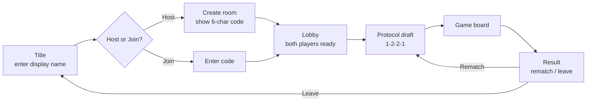
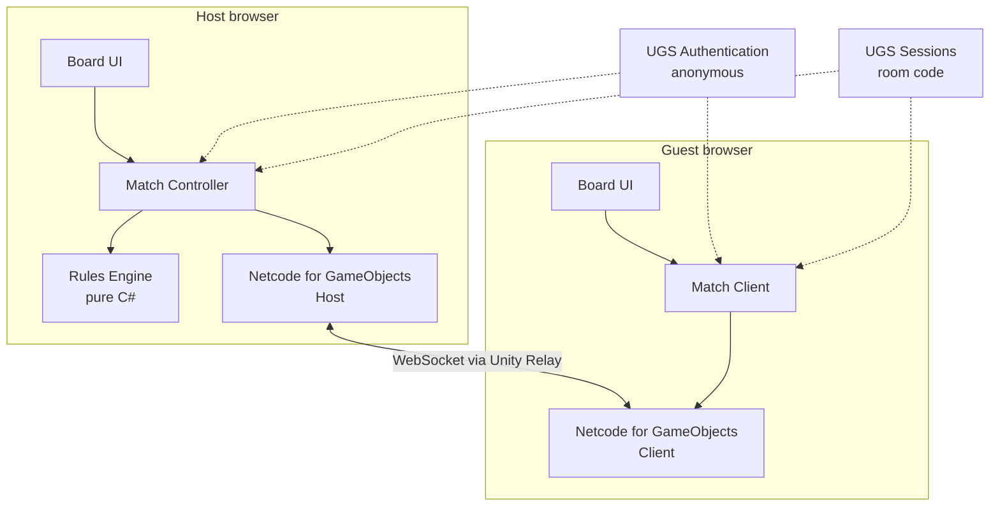

# Compile Online — Design Document

| | |
|---|---|
| **Status** | Draft v0.1 (2026-10-11) |
| **Engine** | Unity 6 (WebGL build) |
| **Players** | 2, online, private matches |
| **Rules source** | [`official/rules.md`](official/rules.md) (rulesheet + Compile Codex, 16 Dec 2024) |
| **Board reference** | [`board-setup.html`](board-setup.html) |

## 1. Overview

A browser-playable version of the card game **Compile**. Two players meet with a room code, draft Protocols, and play a full game against each other in real time. The game enforces every rule, including Control and card effects, so players never have to referee.

### Goals

1. Play a full, rules-correct game of Compile between two browsers.
2. Join a friend with a short room code. No installs, no accounts.
3. Support every Protocol that has art in `resources/img/cards` (15 Protocols).
4. Make hidden information safe enough for friendly play, and keep the rules engine portable so it can move to a dedicated server later.

### Non-goals (first release)

- Public matchmaking, ranked play, or stats.
- Accounts, friends lists, or chat.
- AI opponent (the engine design keeps this possible later).
- Phones. Below the minimum screen size the game shows a "screen too small" message instead of a cramped board (see [Supported screens](#supported-screens)).
- The beginner "no Control" variant. Control is always on.

## 2. Decisions So Far

| Topic | Decision | Why |
|---|---|---|
| Finding a match | Private room codes | Simple, cheap, fits a two-friend game. |
| Backend | Unity Gaming Services: **Authentication** (anonymous), **Multiplayer Services Sessions** (room codes), **Relay** (connection) + **Netcode for GameObjects** | No servers to run. Relay supports WebSockets, which WebGL requires. Free tier covers a hobby project. |
| Authority | **Host-authoritative.** The player who creates the room runs the rules engine; the guest sends moves. | Follows from the UGS choice. See [Hidden information](#hidden-information-and-trust) for the cost. |
| Card scope | All 15 Protocols in `resources/img/cards` | Main Set 1 (12) plus Apathy, Hate, and Love. |
| Identity | Guest only: anonymous sign-in plus a display name | No account system to build or secure. |
| Platforms | Desktop browsers and large tablets (touch). No phones. | Tablets are big enough for the board; phones aren't. |

## 3. Player Experience

### Screen flow



### Screens

| Screen | Contents |
|---|---|
| **Title** | Display name field (saved locally), Host and Join buttons, link to the rules. |
| **Host / Join** | Host sees the room code with a copy button and "Waiting for opponent…". Join has a code field with validation and clear error messages ("Room not found", "Room is full"). |
| **Lobby** | Both names, ready toggles. Host picks who drafts first: **random** (default) or host/guest. The rulebook's "youngest player" rule becomes a choice or a coin flip. |
| **Draft** | All 15 Protocol cards (Loading side). Shows whose pick it is and how many picks remain (1-2-2-1). Picks fill left → middle → right spaces in order. |
| **Game** | The board (see below). |
| **Result** | Winner, final board, Rematch and Leave buttons. Rematch keeps the same room and starts a new draft. |

### Game board layout

Matches the physical table and `board-setup.html`:

- Local player's mat at the bottom, opponent's mat at the top rotated 180°, Protocols meeting at the center. Board art is `resources/img/background_1.jpg`.
- Local hand fanned along the bottom edge. Opponent's hand shown as card backs (count only).
- Deck and trash beside each mat with counts. Trashes are public: click to browse.
- Control component on the center line, shown neutral or next to whoever holds it.
- Each line shows both players' totals (e.g. `Fire vs Metal · 7 – 9`) and highlights when someone can Compile.
- A phase bar mirroring the board's banner: `START › CONTROL › COMPILE › ACTION › CACHE › END`, with the current step lit.

### Supported screens

The game page fills the browser window and re-lays itself out on resize and rotation.

| Target | Examples | Viewport (CSS px) | Support |
|---|---|---|---|
| Desktop / laptop | Any modern Chrome, Edge, Firefox, Safari | 1280 × 720 and up | Primary |
| Large tablet, landscape | iPad (10th gen) 1180 × 820, iPad Air / Pro 11" 1194 × 834, iPad Pro 13" 1366 × 1024, Galaxy Tab S 1280 × 800 | Short side ≥ 768 | Supported |
| Large tablet, portrait | Same devices rotated | Short side ≥ 768 | Supported (tall layout) |
| Phones, small tablets | Anything with a short side < 768 | — | "Screen too small" message |

**Two layouts, picked by aspect ratio:**

| Layout | When | Arrangement |
|---|---|---|
| **Wide** | Width ≥ height | Mats in the center column. Deck, trash, and Control beside the mats. Event log in a side panel that can collapse. |
| **Tall** | Height > width | Mats fill the width. Deck, trash, and counts sit in a strip above (opponent) and below (you) the mats. Event log becomes a drawer. |

Rules for both layouts:

- The UI scales with screen size (Canvas Scaler, *Scale With Screen Size*), so cards keep their proportions between 4:3 and 21:9 (and 3:4 in portrait).
- Card text is too small to read at board size on a tablet, so the zoomed card view is the main way to read cards, not a convenience.
- Every touch target is at least 44 × 44 pt.
- Nothing relies on hover, right-click, or keyboard modifiers. Those are shortcuts only; every action has an on-screen control.

### Interactions

Every action works with a mouse and with touch.

| Action | Mouse | Touch |
|---|---|---|
| Play a card | Drag from hand to a line, or click the card then click a line. | Drag, or tap the card then tap a line. |
| Choose orientation | On-screen **Face-up / Face-down** toggle on the selected card. Right-click flips it as a shortcut. | The same on-screen toggle. |
| Show legal moves | Legal lines highlight and illegal ones dim as soon as a card is selected. | Same. |
| Refresh | Button, enabled only when legal (fewer than 5 cards in hand). | Same. |
| Read a card | Hover shows a large view; click the magnifier for a pinned view. Covered cards can be inspected too. | Long-press shows the large view until you lift your finger; the magnifier pins it. |
| Answer a choice | The engine asks for choices ("Choose 1 card to flip", "Discard 1 card", "You may shift…"). Valid targets glow. Optional choices get a **Skip** button. | Same, with tap. |
| Rearrange Protocols (Control) | Drag Protocols into a new order on either side, then **Confirm** or **Don't rearrange**. Confirm is disabled until the order is different. | Drag, or tap two Protocols to swap them. |
| Clear Cache | Select cards to discard until you hold 5. | Same, with tap. |
| Browse a trash | Click the trash. | Tap the trash. |

Dragging on touch needs a small dead zone (about 10 px) so a tap isn't read as a drag.

The opponent sees each action animate: card flying from hand, flips, shifts, deletes to trash. A short log panel lists events in plain language ("Opponent played a card face-down into Fire vs Metal").

## 4. Architecture



### Layers

| Layer | Responsibility | Unity dependency |
|---|---|---|
| **Rules Engine** | Game state, legal moves, turn phases, effect resolution, card definitions. Deterministic, given a seed. | **None** (plain C# assembly, `noEngineReferences: true`). |
| **Match Controller** (host) | Owns the engine instance, receives player intents, validates them through the engine, sends each player their own view. | Light |
| **Match Client** (both) | Holds the latest player view, turns events into animations, sends intents. The host's own UI uses the same client path locally. | Yes |
| **Networking** | Session creation/join, Relay transport, RPCs. | Yes (NGO, UGS) |
| **Presentation** | Board, cards, drag and drop, animations, screens. | Yes |

Keeping the engine free of Unity references means it can be unit tested quickly, run headless for an AI opponent later, or move to a .NET dedicated server without rewriting rules.

### Assemblies (asmdefs)

```
Compile.Engine          (pure C#, no UnityEngine)
Compile.Engine.Cards    (card definitions, depends on Engine)
Compile.Engine.Tests    (EditMode tests)
Compile.Net             (NGO, UGS)
Compile.Client          (presentation, UI)
```

## 5. Rules Engine

### State model

```
GameState
  Seed, Rng
  Turn, ActivePlayer, Phase
  Control: Neutral | Player(0|1)
  Players[2]
    Protocols[3]      (ProtocolId, Compiled: bool)   // index 0..2 = left..right from that player's seat
    Deck              (ordered list, hidden)
    Hand              (list, hidden from opponent)
    Trash             (list, public, all face-up)
  Lines[3]
    Stacks[2]         (ordered cards, bottom → top; last = uncovered)
  ResolutionStack     (pending effects, LIFO)
  Committed           (cards entering the field, in order)
  PendingChoice       (null, or a question for one player)

CardInstance
  InstanceId, DefinitionId (e.g. "Fire_4"), Owner, FaceUp
```

- **Line mapping:** a player's Protocol at index `i` sits in field line `i` from their own seat. The opponent's Protocol in that line is their index `2 - i`. Rearranging Protocols changes which Protocol sits in which line; cards stay put.
- **Line value:** sum of the stack's values. Face-down cards count **2**. Persistent effects may modify values.
- **Ownership:** each card has an `Owner` that can change (Recompile draws from the opponent's deck). Cards go to their current owner's trash.

### Turn loop

```
Start   → queue visible Start effects (owner picks order) → resolve
Control → if leading in ≥ 2 lines, take Control
Compile → if any line qualifies, player picks one (if > 1) → Compile → skip Action
Action  → Play | Refresh (forced Refresh at 0 cards; skip if nothing is possible)
Cache   → if hand > 5, discard down to 5
End     → queue visible End effects → resolve
→ next player
```

Compile order: Control return + optional rearrange → delete all cards in the line simultaneously (no triggers) → flip Protocol, or draw opponent's top card on a Recompile. Check victory after every Compile.

### Effects and triggers

Card text is too varied to describe fully as data, so each card is a small C# class built from shared primitives:

| Primitive | Notes |
|---|---|
| `Draw(n)` | Batch draw, reshuffles trash when deck is empty, then fires draw triggers once. |
| `Discard(n)` | Batch discard from hand (or top of deck), then fires discard triggers once. |
| `Flip`, `Shift`, `Delete`, `Return`, `Reveal` | Target uncovered cards unless the effect says "covered" or "all". |
| `PlayFrom(source, orientation)` | Plays from deck top, trash, etc. Does nothing on an empty deck. |
| `Rearrange(player)` | Must produce a different order. |
| `Choose(player, filter, min, max, optional)` | Raises a `PendingChoice` and suspends resolution until answered. |

Card text has three slots, matching the card anatomy:

| Slot | Engine hook |
|---|---|
| **Top (Persistent)** | Active while face-up, covered or not. Either a rule modifier (e.g. "may play without matching Protocol", "opponent can't compile") or a trigger (Start/End, "when this would be…"). |
| **Middle (Immediate)** | Runs when played face-up, flipped face-up, or uncovered. |
| **Bottom (Auxiliary)** | Active only while face-up and uncovered. Usually triggers. |

Resolution rules the engine must enforce (from the Codex):

- Effects resolve **last in, first out**. New active text interrupts what is resolving.
- If the source card is covered, flipped, or removed mid-resolution, its remaining text is cancelled.
- Each sentence resolves separately; "if you do" clauses check completion; text without "may" is mandatory and resolves as fully as possible.
- **Committed** cards can't be targeted and always land in their chosen line and orientation. "When this would be covered" triggers fire before the committed card lands.
- Start/End effects use only what was visible when the phase began.
- Cards may break rules when their text says so. Model this with rule-modifier queries (`CanPlayFaceUpIn`, `CanCompile`, `ValueOf`) that persistent effects can override.

### Choices and suspension

The engine never blocks. When a decision is needed it stores a `PendingChoice { Player, Prompt, ValidTargets, Min, Max, Optional }` and returns. The controller sends the prompt to that player, waits for an answer, validates it, and resumes. This keeps networking simple and makes an AI player a matter of answering the same prompts.

### Card data

Card text comes from the community card database at [chuckplayer/compile](https://github.com/chuckplayer/compile), copied into this folder:

| File | Contents |
|---|---|
| [`cards.json`](cards.json) | 180 cards (30 Protocols × 6). Each card has `protocol`, `value`, `top` / `middle` / `bottom` (each `{ emphasis, text }`, where `emphasis` holds trigger words like "Start:" or "When this card would be covered:"), `keywords`, and `set`. |
| [`protocols.json`](protocols.json) | 45 Protocols with their tagline (`top`), focus keywords (`bottom`), and `set`. |

- All 15 Protocols we have art for are in `cards.json`, and their values match the art filenames exactly. The Codex errata (Death 1, Fire 0, Life 0, Metal 1, Spirit 1, Hate 2) are already applied.
- The files cover more than we need: `cards.json` also has 15 Protocols we don't have art for, and `protocols.json` lists 15 more beyond those. Import only Protocols that have an art folder.
- `CardDefinition`: `Id`, `Protocol`, `Value`, `Set`, `Top`, `Middle`, `Bottom` (emphasis + text), `Keywords`, `ArtPath`, effect class.
- Card ids combine Protocol and value (e.g. `Gravity_6` ↔ `resources/img/cards/Gravity/6.gif`). Values per Protocol are not always 0–5: Gravity has no 3, Metal has no 4, Love runs 1–6.
- An editor import step reads `cards.json` into ScriptableObjects (or a runtime JSON asset) so tooltips and effect code share one source of text. The text is for display and reference only; behavior lives in each card's effect class.
- `cards.json` is community-maintained. If it disagrees with a newer Codex ruling, the Codex wins. Record any local fixes so they can be sent upstream.

## 6. Networking

### Session setup

1. Both clients sign in with **UGS Authentication** (anonymous). The display name is stored as a player property.
2. Host calls `MultiplayerService.CreateSessionAsync` with `MaxPlayers = 2` and Relay networking. The session's join code is the room code.
3. Guest calls `JoinSessionByCodeAsync(code)`.
4. NGO starts as Host / Client over **Unity Transport with `UseWebSockets = true`**. WebGL can only use WebSockets.

### Messages

All gameplay goes through RPCs. NetworkVariables aren't used for game state because each player must get a different view.

| Direction | Message | Payload |
|---|---|---|
| Client → Host | `SubmitIntent` | `PlayCard(cardId, line, faceUp)`, `Refresh`, `AnswerChoice(targets)`, `DraftPick(protocol)`, `Rearrange(order)`, `Concede` |
| Host → Client | `ApplyEvents` | Ordered list of redacted events since last update (for animation) plus a state version number. |
| Host → Client | `FullSnapshot` | Complete redacted view. Sent on join, on reconnect, and if versions drift. |
| Host → Client | `PromptChoice` | The pending choice, if it belongs to this player. |
| Host → Client | `IntentRejected` | Reason, for when a move fails validation. |

### Redaction (per-player view)

| Data | Owner sees | Opponent sees |
|---|---|---|
| Hand | Cards | Count |
| Deck | Count | Count |
| Face-down card in field | Card identity | "Face-down, value 2" |
| Card played from deck top face-down | Identity once it's in the field | Hidden |
| Reveal effect | Card | Card (for the reveal), then hidden again |
| Trash, face-up field cards | Everything | Everything |

### Hidden information and trust

With a host-authoritative design, the **host's browser holds the full game state**, including the guest's hand and deck order. A determined host could read it with debugging tools. For private games between friends that's an acceptable trade-off, but it should be stated plainly in the game ("Matches are hosted by the player who creates the room").

The mitigation path is already built into the architecture: because the engine has no Unity dependencies, it can later run on a dedicated server (UGS Multiplay, Cloud Code, or a small .NET service) with both browsers as clients, and the message protocol stays the same.

### Disconnects

| Situation | Behavior |
|---|---|
| Guest disconnects | Host pauses the match and waits up to 2 minutes. Guest rejoins with the same code and receives a `FullSnapshot`. After the timeout, host wins by forfeit. |
| Host disconnects | The match ends (state lives on the host). Guest sees "Host left the game". A later version could save state for resume. |
| Tab hidden / backgrounded | Treated as connected while the socket holds. No turn timer in the first release. |

## 7. Art and Assets

- **GIF conversion:** Unity doesn't import `.gif` as textures. Convert all card art in `resources/img/cards` to PNG during import (one-time script), keeping folder and file names.
- **Card size:** source art is 372 × 521. Use it at native size for zoomed views and downscale for the board.
- **Protocol cards:** `A` = Loading side, `B` = Compiled side. They sit sideways at the center end of each lane (rotated 90°).
- **Card back:** `Cardback.gif` for face-down cards, hands, and decks.
- **Control:** `Control/A.gif` and `Control/B.gif` (check which side means what; the rulesheet doesn't say).
- **Unknown card:** `404.jpg` as a fallback if an image is missing.
- **Board:** `background_1.jpg` (1398 × 1500) as each player's mat. Lane positions are measured in `board-setup.html`.
- **Atlases:** pack each Protocol's 8 images into a Sprite Atlas to cut draw calls and download size.

## 8. WebGL Build

| Concern | Plan |
|---|---|
| Transport | Unity Transport over WebSockets (required in browsers). |
| Threads | WebGL has no threads. Keep engine work synchronous and small. UGS async calls are fine. |
| Download size | Target < 25 MB compressed. Brotli compression, IL2CPP code stripping, compressed sprite atlases. |
| Hosting | Any static host that serves Brotli files with the right headers (itch.io, Unity Play, GitHub Pages with decompression fallback, Cloudflare Pages). |
| Input | Unity Input System with pointer events, so mouse and touch share one code path. Long-press and tap-to-select are built on top. |
| Page template | Custom WebGL template: the canvas fills the window and resizes with it. Viewport meta disables pinch zoom; CSS sets `touch-action: none`, disables text selection and the iPad long-press callout on the canvas, and stops the page from scrolling or bouncing. |
| Resolution | Cap the rendering pixel ratio at 2 so high-density tablet screens don't render at full native resolution. |
| Textures | Build with both desktop (DXT/BC) and tablet (ASTC) texture compression so each device downloads a format its GPU supports. |
| Memory | iPad Safari has tight per-tab memory limits. Keep the WebGL heap small (target under 512 MB) and keep card art in atlases rather than loose textures. |
| Fullscreen | A fullscreen button where the browser supports it. Add a web app manifest so iPad users can add the game to the home screen and play without the browser bar. |
| Audio | Starts after first click (browser autoplay rules). |

## 9. Testing

- **Engine unit tests (EditMode):** turn order, Compile conditions, Recompile, Control and rearrange rules, deck reshuffle, Clear Cache, face-down value, all/each targeting, committed cards, LIFO resolution, effect cancellation.
- **Card tests:** at least one scenario per card, plus every Codex clarification (Light 0 value after flip, Metal 6 self-delete, Speed 2 during Compile, Plague 3 uncovered-only, Hate 2 self-delete, etc.).
- **Scenario format:** set up a `GameState` from a compact text description, apply intents, assert the result. Seeded RNG makes tests repeatable.
- **Random play fuzzing:** two random agents play thousands of games headless. Assert invariants (card count is conserved, no illegal states, games terminate).
- **Network testing:** Unity **Multiplayer Play Mode** to run host and guest in one editor, then real WebGL builds in two browsers.
- **Device testing:** each milestone build is played on a desktop browser and at least one large tablet (an iPad in Safari plus an Android tablet in Chrome), in both orientations. Check rotation mid-game, long-press zoom, drag vs. tap, and memory use on the iPad.
- **Redaction tests:** for every event type, assert the opponent's view contains no hidden card identities.

## 10. Milestones

Task-level detail for each milestone is in [`plan.md`](plan.md).

| # | Milestone | Done when |
|---|---|---|
| 0 | **Foundation** | Project builds for WebGL; card art and card data imported. |
| 1 | **Setup screens** | Title, Host/Join, Lobby, Draft, and Result screens navigate correctly with stand-in data, in wide and tall layouts. |
| 2 | **Board layout** | One player's board with real art: play cards, card zoom, piles, phase bar, wide and tall layouts. No engine or networking. |
| 3 | **Engine core** | Full turn loop, Compile, Control, deck/trash with vanilla (text-less) cards. Tests pass. |
| 4 | **Hot-seat prototype** | The board from milestone 2 runs on the engine; two players on one machine play a full game. |
| 5 | **Card effects: Main Set 1** | All 12 Main Set 1 Protocols implemented with tests. |
| 6 | **Online play** | Room codes, draft, and full games between two WebGL builds via Relay. |
| 7 | **Polish and tablets** | Animations, sound, reconnect, rematch. Verified on desktop and tablets in both orientations. |
| 8 | **Expansion Protocols** | Apathy, Hate, and Love implemented and tested. |
| 9 | **Release** | Hosted WebGL build, size and performance checks, rules page linked in-game. |

## 11. Open Questions

1. ~~**Card text source.**~~ Resolved: [`cards.json`](cards.json) from chuckplayer/compile (see [Card data](#card-data)).
2. **Expansion rules.** Apathy, Hate, and Love (set AX01) may introduce terms or rules not in `rules.md` (Love's focus lists "Gift" and "Exchange"). Do we have their rulesheets?
3. **Control card sides.** What do `Control/A` and `Control/B` mean (neutral vs. held, or just two faces)?
4. **First player.** Random coin flip, or let players choose?
5. **Turn timer.** None at first. Add an optional chess-clock style timer later?
6. **Concede and draw states.** Is there any way a game can stall (both decks and trashes empty)? Decide a rule if so.
7. **Spectators.** Out of scope for now. Worth keeping the redacted-view design open for a third "spectator" view?
8. **Moving to a dedicated server.** At what point (public matchmaking, competitive play) is the hidden-information risk no longer acceptable?
