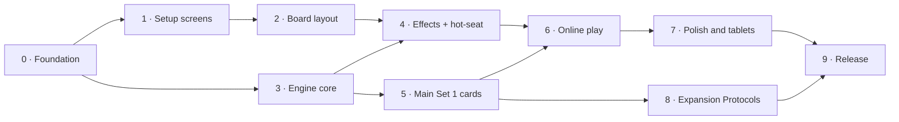
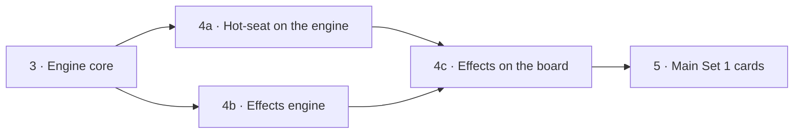

# Compile Online — Implementation Plan

| | |
|---|---|
| **Status** | Draft v0.2 (2026-10-11) |
| **Design** | [`design.md`](design.md) |
| **Rules** | [`official/rules.md`](official/rules.md) |
| **Card data** | [`cards.json`](cards.json) |

This plan breaks the work into phases that each end in something playable or testable. The phases follow the milestones in [design.md §10](design.md#10-milestones). Each phase lists its goal, tasks, and the checks that mark it done.

## Overview

| Phase | Goal | Playable result | Size |
|---|---|---|---|
| 0 | Foundation | Project builds for WebGL; art and card data in Unity | S |
| 1 | Setup screens | Click through Title → Host/Join → Lobby → Draft → Result with stand-in data | M |
| 2 | Board layout | One player's board with real cards, drag to play, wide and tall layouts | M |
| 3 | Engine core | A full game runs in tests with text-less cards | M |
| 4 | Effects framework + hot-seat (4a–4c) | Two people play a full game on one screen; every kind of card effect works and can be triggered from the Debug menu | L |
| 5 | Main Set 1 cards | All 72 Main Set 1 cards work, with tests | L |
| 6 | Online play | Two browsers play a full game with a room code | L |
| 7 | Polish and tablets | Animations, sound, reconnect; verified on iPad and Android tablets | M |
| 8 | Expansion Protocols | Apathy, Hate, and Love (18 cards) work | S |
| 9 | Release | Public, hosted WebGL build | S |

**Two tracks after Phase 0.** Phases 1–2 are presentation work (`Compile.Client`) and Phase 3 is rules work (`Compile.Engine`). They don't depend on each other and can run at the same time. They meet in Phase 4, where the board from Phase 2 is wired to the engine from Phase 3.

## Working Rules

These apply to every phase.

- **Engine first, tests always.** Rules live in `Compile.Engine` / `Compile.Engine.Cards` with no Unity references. Every rule and card lands with EditMode tests.
- **UI reads view data, not engine internals.** Screens and the board render from plain view-model types (e.g. `PlayerView`, `LobbyView`). In Phases 1–2 a stub fills them; later the engine and network fill them. Swapping the source shouldn't require UI rewrites.
- **The Codex wins.** When `cards.json` or `rules.md` is unclear, follow `official/The_Compile_Codex.pdf`, and record the ruling in a test name or comment.
- **Small commits on `main`.** Each commit compiles and passes tests. Use short-lived branches for anything that spans days.
- **Build often.** Run a WebGL build at the end of every phase, not just at release, to catch size and platform problems early.
- **Update the docs.** If a phase changes a decision in `design.md`, update the design in the same change.

---

## Phase 0 — Foundation

**Goal:** everything needed to start writing game code is in place.

### Done

- [x] Rules summary (`official/rules.md`) with Codex clarifications
- [x] Design document (`design.md`)
- [x] Card text (`cards.json`) and Protocol list (`protocols.json`)
- [x] Unity 6 project (6000.6.5f1, URP 2D) at the repo root
- [x] Packages: Netcode for GameObjects, Multiplayer Services, Authentication, Multiplayer Play Mode, Input System, uGUI/TextMeshPro, Test Framework
- [x] Assemblies: `Compile.Engine`, `Compile.Engine.Cards`, `Compile.Net`, `Compile.Client`, `Compile.Engine.Tests`
- [x] WebGL build profile, Brotli compression, full-window page template; first WebGL build succeeds (13.8 MB)

- [x] **Import card art.** 127 images copied to `Assets/Compile/Art/` (`Cards/<Protocol>/`, `Cards/Control/`, `Board/`, `UI/`). Unity imports the GIFs directly, so no PNG conversion was needed.
- [x] **Sprite import settings.** `ArtImportSettings` applies sprite settings on first import (no mipmaps, max 1024; 2048 for the board).
- [x] **Sprite atlases.** One per Protocol plus `Shared`, generated by `CardAtlasGenerator` before every build. Verified they pack.
- [x] **Card data import.** `Assets/Compile/Data/cards.json` and `protocols.json` (15 Protocols, 90 cards), loaded with `CardDatabase.Parse`. Decision: runtime JSON.
- [x] **Tests.** 6 EditMode tests for the card data (counts, art for every card, printed values, Codex errata).
- [x] **Remove bootstrap scripts** from `Assets/Editor/ProjectBootstrap/`.
- [x] **Link Unity Cloud.** Linked to the new Unity Cloud project "UnityClaude" (`40659849-96d8-4901-8366-44626af0f5f7`) in the GeekCastle organization.
- [x] **Test run from the command line.** `unity test . --mode EditMode` passes (6/6) with the Editor closed.

**Done when:** art shows up as sprites in the Editor, card data loads in a test, and the Unity Cloud project ID is set. ✅ Complete (2026-10-11).

---

## Phase 1 — Setup Screens

**Goal:** every screen before and after a game exists, looks right, and navigates correctly, using stand-in data. No networking and no rules engine.

Covers the screens in [design §3](design.md#screens): Title, Host/Join, Lobby, Draft, and Result.

Decided at the start of this phase: **uGUI**, and a **tabletop presentation** (see [design: Tabletop presentation](design.md#tabletop-presentation)): `PlayMat.jpg` on a sci-fi desk, menus as panels lying on the desk, and a camera that moves between shots.

### Tasks

**Shell**

- [x] Table scene built at startup by `AppRoot`: desk surface shader, `PlayMat.jpg`, camera, EventSystem (Input System UI module)
- [x] `CameraRig` with shots (menu, draft, board, result) that solve for the camera distance at any aspect ratio, with eased transitions
- [x] Navigation: `Navigator` + `TableScreen` / `MenuScreen` (panels settle onto the desk and lift away)
- [x] Visual style: `Theme` asset, Chakra Petch + Share Tech Mono TMP fonts, palette from the mat art, generated chamfered 9-slice panel sprites
- [x] Shared components (`Ui`): panels with shadow, text styles, primary/secondary/quiet buttons with hover, pressed, selected, and disabled states, text input
- [x] Screen-space `Hud`: status bar, toasts, hover details, action buttons
- [x] Session stub: `ISessionService` (in `Compile.Net`) and `FakeSessionService`, driven by a clock rather than threads so it works in WebGL and in tests
- [x] Draft order in the engine (`Compile.Engine.Draft`), reusable in Phase 3
- [ ] Modal dialog and loading spinner (not needed by any Phase 1 screen; build when first needed)

**Screens**

- [x] **Title:** title, display name field (saved locally), Host and Join buttons, How to play, version number
- [x] **Host:** 6-character room code with Copy (browser clipboard in WebGL), "Waiting for an opponent…", Cancel
- [x] **Join:** code field (uppercase, letters and numbers only), Join button, error messages. Codes starting with X or F trigger "Room not found" and "Room is full"
- [x] **Lobby:** both display names with host/guest and ready state, ready toggle, first-player choice (Random / Host / Guest, host only), Start when both are ready, Leave
- [x] **Draft:** played on the mat. 15 Protocols spread over the local lanes, status shows the pick number and whose turn, the next slot pulses, picks glide into their slot, resting the pointer on one shows its tagline and focus in the docked card reader beside the pool. The stub opponent picks at random
- [x] **Board preview:** tilted view over the local half with the drafted Protocols, plus debug actions (simulate win or loss, opponent leaves, leave game)
- [x] **Result:** Victory/Defeat panel on the local lanes, the winner's Protocols flip to Compiled, Rematch (loser drafts first) and Leave
- [x] **Rules:** scrollable condensed rules (`rules-summary.txt`) reachable from Title

**Layout**

- [x] Every screen works in wide (landscape) and tall (portrait) aspect ratios (checked with captures at 1600 × 900 and 820 × 1180)
- [x] Touch-friendly sizes: controls are 96 canvas px tall, about 44 pt or larger at the menu framing
- [x] Hover-only detail: fixed in Phase 2. Long-press (touch) on a draft card opens the large zoom; resting the pointer (desktop) shows it in the card reader

**Tests:** 24 EditMode tests pass (card data, draft order, fake session service, room code validation).

**Build:** WebGL builds with no errors; the download is 21.1 MB compressed (10.8 MB data + 10.0 MB code), under the 25 MB target. Getting there took crunch compression on all art and atlases, padding the mat into a 2048 × 4096 texture so it compresses with mipmaps, and turning off the Unity splash screen.

**Status:** the full flow (Title → Host → Lobby → Draft → board preview → Result → Rematch, plus Join errors and Rules) has been played through in the Editor at wide and tall sizes. Still to do: play the WebGL build in a desktop browser and on a tablet.

**Done when:** you can click through Title → Host → Lobby → Draft → (placeholder board) → Result → Rematch → Draft in the Editor and in a WebGL build, in landscape and portrait window sizes, and the Join error states can be triggered from the stub.

---

## Phase 2 — Board Layout (Single Player)

**Goal:** the game board looks and handles like the real thing for one player, with real card art, before any rules engine or networking exists. This settles layout, input, and card presentation early.

The board reads a `PlayerView` (the view-model type the engine and network will produce later) from a local stand-in, `BoardSandbox`, that keeps just enough state to move cards around and runs a simulated opponent.

### Tasks

**View model and stub**

- [x] View-model types in `Compile.Engine.Views` (no Unity references, so the engine can produce them): `PlayerView`, `LineInfo`, `StackInfo`, `CardInfo` (hidden cards carry no id), `ProtocolInfo`, `SideInfo`, `ChoiceInfo`, `LogEntry`, `TurnPhase`, `ControlHolder`. Everything is from the viewer's seat; lines run from the viewer's left.
- [x] `BoardSandbox`: builds 18-card decks from the drafted Protocols, deals 5, plays face-up (only into a line with a matching Protocol on either side) or face-down (any line, worth 2), refreshes, reshuffles the trash, compiles, rearranges, and asks choices. 9 tests.
- [x] Simulated opponent: its own deck and hand, plays a card each turn (face-up when it can), refreshes when empty

**Board (on the table)**

- [x] `PlayMat.png` with both players' Protocols (Loading and Compiled sides, flipping when compiled)
- [x] Stacks in both players' lanes: covered cards offset so their value and top command stay visible; long stacks squeeze down and then run off the mat toward the player
- [x] Face-down cards show `Cardback` (worth 2); the opponent's face-down cards are hidden from the viewer
- [x] Line totals on the center line between the Protocol rows (opponent above, you below); green or red when a side can compile
- [x] Wide screens: deck, trash, and the Control component on the desk beside the mat (Control slides toward whoever holds it)

**HUD**

- [x] Hand fanned along the bottom edge; cards rest partly below the screen and rise when hovered or selected
- [x] Phase bar `START › CONTROL › COMPILE › ACTION › CACHE › END` with whose turn it is
- [x] Player summaries (hand, deck, and trash counts; Control); the opponent's hand shows as a count
- [x] Event log (side panel on wide screens, drawer on tall)
- [x] Trash browser (tap a trash or summary; tap a card to zoom it)

**Interaction**

- [x] Play a card: drag from the hand onto a lane, or tap the card then tap a lane
- [x] Face-up / face-down toggle for the selected card; right-click flips it as a shortcut; a FACE-DOWN badge shows on the card
- [x] Lane highlighting: legal lanes pulse, illegal ones darken
- [x] Refresh button (enabled only below 5 cards)
- [x] Card zoom: long-press or the Zoom button opens a large pinned view with the card's text; works on covered cards, Protocols, the trash, and the draft
- [x] Card reader (also used in the draft): a docked panel with the card's text that keeps the lanes clear (left column between the summaries on wide screens, under the top strip on tall ones). It shows the selected hand card (with the side it will be played on), or a hovered card once the pointer rests on it for 0.5 s. Nothing new shows while a pointer is pressed or a card is dragged, and a press clears a hovered view. Long cards drop the thumbnail, then grow over your summary. Tapping the panel hides it until the selection changes
- [x] Choice prompt (debug "Choose a card to flip"): uncovered cards glow, others stop responding, Skip when optional
- [x] Rearrange (debug): tap two Protocols to swap, Confirm only once the order differs, Don't rearrange puts them back; cards in the lines stay put

**Layouts**

- [x] **Wide:** corner boxes for the summaries and actions, log at the right, prompt middle-left, desk items beside the mat
- [x] **Tall:** the mat fills the width; a thin strip under the phase bar (opponent, Debug, Log) and one above the hand (you, Face-up, Face-down, Refresh); desk items hidden
- [x] Switches automatically on resize and rotation (checked at 1600 × 900 and 820 × 1180 in the Editor Game view)
- [x] Debug menu: deal a sample board, fill stacks, opponent plays, cycle Control, compile a line, choose a card to flip, rearrange, simulate win or loss, opponent leaves, leave game

**Tests:** 33 EditMode tests pass (9 new for the sandbox).

**Not done in this phase**

- [ ] Turn structure isn't enforced: the stand-in only lets you act in your Action step and plays a simple opponent turn. Start/End effects, Control checks, compiling, and Clear Cache come with the engine in Phase 3.
- [ ] Card animations are simple glides and flips; richer animation is Phase 7.
- [ ] Not yet tried in a desktop browser or on a real tablet.

**Done when:** in the Editor and a WebGL build, one player can draft (Phase 1 screens), land on the board, and play their whole hand into lines face-up and face-down with correct highlights and totals, in both wide and tall layouts. Cards are readable via zoom at tablet window sizes.

---

## Phase 3 — Engine Core

**Goal:** a complete game of Compile runs inside the engine, with cards that have values but no text. Can run in parallel with Phases 1–2.

The engine is `Compile.Engine.Game` (no Unity references), in `Assets/Compile/Engine/Game/`. Players submit `Intent`s; the engine checks them, applies them, and runs forward on a last-in-first-out step stack until it needs input again (an action or a `PendingChoice`). It never blocks.

### Tasks

**State and setup**

- [x] `GameState`, `PlayerState`, `Line`, `CardInstance`, `ProtocolSlot` per [design §5](design.md#state-model); `CardCatalog`/`CardSpec` (Protocol and value) built from `CardDatabase.ToCatalog()`
- [x] Seeded RNG (SplitMix64, the same on every runtime); deterministic Fisher–Yates shuffle
- [x] Draft (1-2-2-1) with left → middle → right placement, as `DraftPick` intents; `Game.CreateDrafted` skips it
- [x] Deck building (6 cards × 3 Protocols), opening hands of 5
- [x] Line mapping between seats: field lines are numbered from seat 0's left; a seat's own line `i` is field line `i` (seat 0) or `2 - i` (seat 1). Intents, choices, and views use the player's own numbering

**Turn loop**

- [x] Phases: Start → Control → Compile → Action → Cache → End
- [x] Line value (face-down = 2), Control check (lead in ≥ 2 lines, from neutral or the opponent; only the active player checks)
- [x] Play face-up (matching Protocol on either side) / face-down (any line)
- [x] Refresh (only below 5 cards), forced Refresh at 0 (automatic), Action skipped when the player can neither play nor draw
- [x] Draw as one batch, shuffling the trash into a new deck when needed
- [x] Clear Cache (discard down to 5)
- [x] Compile: Control return + optional rearrange → simultaneous delete (cards to their owners' trashes, face-up) → flip the Protocol now in that line, or Recompile (draw the opponent's top card, which changes owner). Compiling replaces the Action; one line per turn, the player chooses if several qualify
- [x] Rearrange validation (a real permutation, different from the start; Compiled status moves with the Protocol, cards stay)
- [x] Victory check after each Compile
- [x] House rulings for situations the rules don't cover (stalemate, Refresh with nothing to draw); see [rules.md](official/rules.md#house-rulings)
- [x] Empty-deck top-card effects do nothing: `PlayTopOfDeck` (Phase 4b) does nothing on an empty deck and doesn't reshuffle

**Interfaces**

- [x] `Intent` types: `DraftPick`, `PlayCard`, `Refresh`, `AnswerChoice`, `Rearrange`, `Concede`
- [x] `IntentResult` with the `GameEvent`s it caused (for animation and the log); each event can describe itself for a viewer without revealing hidden cards
- [x] `PendingChoice` (cards, line, or rearrange; min/max; optional) used for Clear Cache, choosing the line to compile, and Control's rearrange
- [x] `Game.ViewFor(seat)` builds the same `PlayerView` the Phase 2 board reads, now with the draft, outcome, `CanAct`/`CanRefresh`, and richer `ChoiceInfo`
- [x] Redaction: the opponent's hand and deck are counts, their face-down cards have no identity, and a card gets a new random id whenever it goes into a hand or deck, so it can't be recognized when it's later played face-down
- [x] Rule queries the Phase 5 persistent effects will hook into: `CardValue`, `LineValue`, `CanPlayFaceUp`, `CanCompile`; comments mark where Start/End effects, middle text, and draw/discard triggers will resolve

**Testing**

- [x] `Scenario` helper: build a game from a compact text description (Protocols, hands, decks, trashes, stacks with face-down and owner marks, phase, Control)
- [x] Tests for every rule above, named after the rule (`Compile_DeletesBothSidesAndFlipsTheProtocol`, `Control_TiesDontCountAsALead`, …): 55 engine tests
- [x] Random-agent fuzzer: random drafts, plays, refreshes, and choice answers, checking after every move that 36 cards exist with unique ids, every card is where its owner rules say, hands stay within limits, games end, and neither view leaks hidden cards. 200 games run with the normal tests; the 10,000-game run is `Fuzz_10000RandomGames` (explicit, a few minutes)
- [x] Redaction tests: the opponent's view and log never contain hidden card identities or ids

**Done:** 10,000 fuzzed games end with no invariant failures, and every rule in `rules.md` other than card text has a test.

---

## Phase 4 — Effects Framework and Hot-Seat

**Goal:** two people play a full game on one screen in the Editor, using the Phase 2 board driven by the Phase 3 engine. Every effect a card can produce works in the engine and has board UI, so Phase 5 only adds card classes.

**Why this phase is bigger than "hot-seat":** in Compile, a player's own choices are only Play or Refresh, which line to compile, Clear Cache, and Control's rearrange, and Phase 3 implements all of them. Flip, shift, discard, delete, return, reveal, give/take, and play-from-deck happen **only** when card text says so ([rules](official/rules.md#rules-details)). So the effect building blocks, and every kind of question card text can ask, are built here, before any card has text.

The work is split into three parts:

| Part | Goal | Playable result | Size |
|---|---|---|---|
| 4a | Hot-seat on the engine | Two people play Compile without card text on one screen | M |
| 4b | Effects engine | Every effect and kind of question works in tests and the fuzzer | L |
| 4c | Effects on the board | Every effect can be triggered from the Debug menu and answered on the board | M |

4a and 4b don't depend on each other and can run at the same time, as Phases 2 and 3 did. 4a comes first if they run one after the other: it puts the engine in front of real players early, so bugs in the turn flow, Control, and compiling show up before effects make everything harder to debug.

### Kinds of question card text asks

Surveyed from `cards.json` (counts are cards whose text uses the word).

| Kind | Examples | Count |
|---|---|---|
| Pick card(s) on the field, filtered by side, covered/uncovered, face-up/down, "other", or line | Fire 0 "flip 1 other card", Darkness 0 "shift 1 of your opponent's covered cards" | flip 25, delete 16, shift 14, return 4 |
| Pick card(s) from your hand | Discard N; Love 3 "give 1 card"; Darkness 3 "play 1 card face-down in another line" | discard 28, give 2 |
| Pick a line | Shift destination; Gravity 1 "to or from this line"; Light 3 "to another line" | shift 14, play 11 |
| Pick an option / "may" yes-no | Spirit 1 "Either discard 1 card or flip this card"; Light 2 "you may shift or flip that card" | may 14, either 2 |
| Rearrange or swap Protocols (own or opponent's) | Water 2, Psychic 2, Spirit 4 "swap 2 of your protocols" | 3 |
| Order simultaneous effects | Start/End effects; "each" (Plague 3, Life 0, Water 1) | each 5, plus Start/End cards |
| Reveal (shown to both, then hidden again) | Psychic 0 "reveals their hand"; Light 2 "reveal 1 face-down card" | 4 |
| No question (the engine does it) | Draw; draw the opponent's top card (Love 1); take a random card (Love 3); play the top of a deck (Gravity 6, Life 0, Water 1) | — |

### 4a — Hot-seat on the engine

**Goal:** two people play a full game of Compile without card text on one screen, on the real engine.

**Match**

- [x] `MatchController` (`Client/App/MatchController.cs`) owns a `Game` and replaces the Phase 2 `BoardSandbox` (deleted, with its tests). Each seat is a person at the screen or `RandomBot`, which plays the offline stand-in opponent (and drives the fuzzer)
- [x] Board renders the `PlayerView` of the player at the screen; an opaque "Pass to …" screen hides everything between players, including at the start of the game
- [x] All inputs submit engine `Intent`s; illegal moves show the engine's reason as a toast
- [x] Engine events feed the event log (`GameEvent.Describe`)
- [x] Draft picks are confirmed: after each round of picks (1-2-2-1) the player presses **Confirm** (**Start game** after the last), and can **Undo** picks until then; undone picks fly back to the pool. The bot confirms its own picks
- [x] The Draft screen runs the engine's draft (the match starts there); the Result screen shows the engine's outcome (compiled, conceded, or stalemate, including draws) and Rematch keeps hot-seat
- [x] "Local game (two players, one screen)" on the Title screen, with a setup panel for both names; who goes first is random
- [x] Debug menu: auto-play a move or the rest of your turn, concede, opponent leaves, leave game

**Board UI for the questions the engine already asks**

- [x] Hand cards: Clear Cache picks the cards to discard from the hand fan (they rise with a DISCARD label); Confirm shows "n of N"
- [x] Line: choosing which line to compile when several qualify (lanes highlight with the existing `ShowLanes`). Without card effects this can't come up in play, so it's checked in 4c
- [x] Rearrange: Control's optional rearrange of either player's Protocols. Tap two Protocols on the same side to swap them; changing one side puts the other back; Confirm is enabled once the order differs; "Don't rearrange" declines
- [x] Prompt buttons stack on the narrow wide-screen panel and sit in a row on tall screens

**Undo** (see [design §5](design.md#undo))

- [x] **End turn:** the engine stops after the End phase and waits for an `EndTurn` intent before the next turn starts (`Game.ConfirmEndTurn`, on by default; rule tests turn it off), so the whole turn stays undoable until the player confirms it. In hot-seat, End turn leads to the pass screen; the bot ends its own turns
- [x] `Undo` intent: takes back the active player's last decision this turn (a play, Refresh, or answered choice), as many times as they like, back to the start of the turn or the last undo barrier
- [x] Undo by replay: the engine records every accepted intent; undo rebuilds the game from its starting state and replays all but the last. The engine is deterministic, so the replay always matches (a game of a few hundred intents replays in milliseconds). This is simpler than snapshots and can't drift
- [x] Undo barriers: nothing that showed the player new hidden information can be undone (drawing, a reshuffle, taking the opponent's top card on a Recompile). A Refresh is therefore final once its cards are drawn, but a Refresh waiting on Control's rearrange can still be undone
- [x] `PlayerView` has `CanEndTurn`, `CanUndo`, and `UndoBlockedReason`; the board has Undo and End turn buttons (on tall screens they replace the play buttons once the turn is done), Undo in choice prompts, and Ctrl+Z (or Cmd+Z); the log notes "You undid …"
- [x] Draft rounds use the same mechanism: picks wait for an `EndTurn` (confirm) and can be undone until then; the game starts when the last picks are confirmed
- [x] Tests: 13 undo tests (3 for the draft) (each kind of decision, unlimited undo back to the turn start, barriers, only the active player, not across End turn, the log). The fuzzer makes a move, undoes it, and checks the whole game state is identical

**Done when:** two people draft and finish a game without card text in the Editor and in a WebGL build, in wide and tall layouts, with no engine bugs found, undoing moves freely within a turn.

### 4b — Effects engine

**Goal:** every effect a card can produce, and every question it can ask, works in the engine with tests. Engine only, no UI.

**Effect framework** (`Engine/Game/Effects/`, `Game.Effects.cs`; see [design §5](design.md#effects-and-triggers))

- [x] Building blocks on `Effect`: `Draw`, `DrawFromOpponentDeck`, `Refresh`, `Discard`/`DiscardAny`, `Flip`, `Shift`, `Delete`, `Return` (each by `Target` or on a given card), `FlipAll`/`ShiftAll`/`DeleteAll`/`ReturnAll`, `Each`/`EachCard`, `RevealField`/`RevealHand`/`RevealFromHand`, `PlayFromHand`, `PlayTopOfDeck`, `Give`, `TakeRandom`, `Rearrange`, `Swap`, `Choose`, `May`, `ChooseLine`. A `Target` says which field cards qualify (whose, covered, face-up/down, "other", line, any condition)
- [x] Card text is an iterator of building blocks (`IEnumerable<Op>`), run on the existing step stack: interrupts resolve last in, first out, "if you do" checks `Op.Done`, and the rest of a card's text is lost if it's covered, flipped, or leaves the field mid-resolution (a shifted card keeps it)
- [x] Committed cards: a card being played or shifted is in no stack, so nothing can pick it, and it always lands. "When this card would be covered" resolves before it lands; a shift uncovers the card beneath (whose text resolves) before the shifted card lands
- [x] Middle text runs when a card lands face-up, is flipped face-up while uncovered, or is uncovered face-up (by a shift, delete, or return). Ruling: a covered card flipped face-up doesn't run it
- [x] Trigger points: Start and End (only what was visible when the phase began; the owner orders several), after draw, discard, delete, and Clear Cache, and "when this card would be" covered, flipped, or deleted by compiling. Several texts set off at once resolve in the active player's chosen order. Ruling (found by the fuzzer): "when this card would be …" text can't set itself off again while it's resolving, e.g. by flipping its own card
- [x] "All" (at once, includes covered cards) vs. "each" (one at a time, in the active player's order); uncovered-only by default
- [x] Rule-modifier queries persistent text can override: `CardValue`, `LineValue`, `CanPlayFaceUp`, `CheckPlacement` (forbidden plays), `CanCompile`, `CanFlip`, skipping Check Cache, and ignoring middle text. Bottom-slot rules only apply while uncovered. If card text leaves a player nothing legal to play and no Refresh, their Action step is skipped
- [x] `CardEffect` base class with middle text, triggers, and rule hooks, and a `CardEffects` registry from card id (`Fire_4`) to effect. `CardEffects.None` is the default, so every card stays text-less until Phase 5
- [x] A runaway guard: more than 100,000 steps without a question throws instead of hanging

**Choice kinds** (`PendingChoice`/`ChoiceKind` and `ChoiceInfo`)

- [x] `FieldCards`, with a filter and min/max (Phase 3's `Cards` is split into `FieldCards` and `HandCards`; the board uses the kind instead of guessing)
- [x] `HandCards`
- [x] `Line`, with a purpose (compile, shift to, choose) and the card being shifted
- [x] `Option`: labeled choices, including a single optional option for "may"
- [x] `Rearrange` / `Swap`, with the target side fixed or chosen (`ChoiceInfo.Side`)
- [x] `Order`: a list of effects (or lines) to sequence
- [x] `Play`: "play 1 card", answered with a `PlayCard` (face-up/down allowed, lines allowed)
- [x] Reveal: `CardsRevealed`/`RevealEnded` events, and `CardInfo.Revealed`/`SideInfo.RevealedHand` in the view while the revealing text resolves

**Debug effects**

- [x] A dev-only `DebugEffect` intent runs any of the 34 entries in `DebugEffects.All` ("Flip 1 card", "Shift 1 of your opponent's covered cards", …) for the active player, in their Action step or after it, without using up the action

**Tests**

- [x] A scenario test for each building block and choice kind (`EffectTests`, 30 tests); the `Scenario` helper can run a debug effect (`game.Debug("flip-1")`) and give cards made-up text (`TestCard`)
- [x] Framework tests with made-up card text (`CardTextTests`, 29 tests): when middle text runs, interrupts, lost text, "if you do", committed cards, every trigger, and every rule modifier
- [x] Redaction tests cover reveals: revealed cards are visible to both players only while revealed, revealed hand cards get new ids, and shifted or returned face-down cards aren't named to the opponent
- [x] The fuzzer also runs games where every card has random text built from debug effects and players fire random debug effects, checking committed cards land, reveals end, and cards stay on their owner's side. It logs how often each event and choice kind came up

**Undo with effects**

- [x] Undo covers effects and every new choice kind: undoing a choice puts the question back; undoing a play takes back everything its text did (undo by replay needed no changes)
- [x] More undo barriers: plays from the top of a deck, reveals, random takes from a hand, the opponent drawing, and the opponent's answers during the turn (e.g. which cards they discarded)
- [x] Tests for each barrier (`EffectUndoTests`), and fuzzed undo with effects

**Done when:** every building block and choice kind has tests, and 10,000 fuzzed games with random effects and random undos pass. ✅ `Fuzz_10000RandomGamesWithEffects` passes (about 6 minutes; every choice kind and effect event comes up tens of thousands of times).

### 4c — Effects on the board

**Goal:** every effect from 4b can be triggered and answered on the board in a hot-seat game. Depends on 4a and 4b.

- [x] Debug menu: **Card effects…** opens a scrolling panel of all 34 debug effects under headings (`DebugEffects.Entry.Group`); choosing one runs it for the player at the screen
- [x] Field cards: valid ones glow and the rest dim and stop responding; one card is answered by tapping it, several are picked (accent glow) and confirmed with "Confirm (n of N)"
- [x] Hand cards: picks rise with a label saying what happens to them (DISCARD, GIVE, REVEAL), from the choice's new `Verb`. The prompt hint uses it too ("Tap a highlighted card to delete it")
- [x] Lines: lanes light up on the side the question is about: your own to compile, the moving card's side to shift (the card glows), both halves for "1 line". The opponent's half of each line is now a lane target too
- [x] Play ("play 1 card"): pick one of the allowed hand cards, choose a side if both are allowed, then tap or drop on an allowed lane
- [x] Options: a button per option; "may" adds Don't, and other optional questions Skip
- [x] Rearrange and Swap: the rearrange flow only lets you move the side the text names; swap mode starts each swap from the original order, so the answer is always one swap; "Don't rearrange" only shows when it's optional
- [x] Order: a button per effect, numbered as you tap ("1: left line"); cards that line up with the options can be tapped instead; the last one fills itself in; Start over and Confirm
- [x] Reveal: revealed face-down cards turn face-up with a REVEALED badge for as long as the text runs, and at least 2 seconds, with a toast saying what was revealed. A revealed hand (or hand card) of the opponent opens in a panel like the trash browser; your own reveals are a toast
- [x] Animation with the existing `CardView` glide and flip: flips flip, shifts glide, deletes fly to the trash, returns glide off toward their owner's hand, given and taken cards leave your hand upward and arrive from above (richer animation is Phase 7)
- [x] Undo during effects: Undo is in every prompt and takes back effect choices; cards glide back, and a card that comes back out of a trash starts from it. When a barrier blocks undo, the reason shows in the prompt and on the summary strip (tall screens) as well as under the buttons (wide)
- [x] Tests: each card choice reports its `Verb` (including Clear Cache), and every debug effect has a group and a unique key

**Done when:** every effect can be triggered from the Debug menu and answered on the board in wide and tall layouts, in hot-seat in the Editor and in a WebGL build. ⏳ The code is in and compiles; the play-through of all 34 effects in both layouts, in the Editor and a WebGL build, is still to do.

---

## Phase 5 — Main Set 1 Card Effects

**Goal:** all 12 Main Set 1 Protocols (72 cards) work exactly as the cards and Codex say.

### Framework

The effect framework, choice kinds, and their UI are built in Phase 4. This phase adds:

- [ ] Card effect classes registered for every card in scope, with a test that none is missing. The classes are in `Engine.Cards/MainSet1/` (one file per Protocol), registered in `MainSet1.Effects`, which new games use. `MainSet1Tests` checks every MN01 card with text has its effect, except the Protocols in `MainSet1.NotYetWritten`; the list shrinks with each wave and the box is ticked when it's empty
- [ ] Card-specific rule modifiers as the cards need them (e.g. Spirit 1 playing face-up without a matching Protocol, Metal 1 stopping compiles). So far: optional discards ("You may discard 1 card", Fire 3); a turn remembered on a card (`Effect.MarkTurn`/`NextTurnOf`, `CardInstance.MarkedTurn`), so Metal 1 can stop compiling on the opponent's next turn
- [x] The fuzzer has a third mode with the real card text: `Fuzz_200RandomGamesWithMainSet1` in every run, and `Fuzz_10000RandomGamesWithMainSet1` (explicit) for the done-when check
- [x] The board explains what it does on its own: a toast and a log line when text runs because a card was uncovered, flipped face-up, or set off (Start, End, reactions), and when a pick is made for a player because there was no choice (`CardTextRuns`, `ChoiceMadeFor`)
- [ ] The same note when a line is picked for a player because only one line qualifies (Death 2, Metal 3, and the like)

### Game log for bug reports

While playing, the player can save a log of the game and share it, so we can tell whether the game made a mistake or the player missed what it did, and turn a real game into a test.

- [x] **Game record** (`GameRecord`, kept by games made with `Game.Create(..., record: true)`; the client always turns it on): format version, build, platform, mode, card text set (`MainSet1`) and the Protocols without text yet, seed, first seat, player names, the draft pool (or drafted Protocols), and every accepted intent in order, undos included. The engine is deterministic, so that's enough to rebuild any moment of the game
- [x] **Readable transcript**, in the same file. For each move: the turn, phase, and player; the question being answered (prompt, kind, how many, which card it came from, and every card, line, or option that could be picked, with ids and where each card is); the move; every event, described for an all-seeing viewer (`GameEvent.Everyone`) so hidden cards are named; and the board after it (stacks bottom to top with `~` for face-down cards, totals, Protocols and which are compiled, Control, hands, decks in order, trashes). Lines are field lines, "1st line" to "3rd line" from the first seat's left
- [x] Rule notes: moves the engine refused are listed with the reason ("(not allowed) Bob plays ...: Metal 2: you can't play cards face-down in this line."), but not replayed; text set off by uncovering or flipping, and picks made for a player, come from the `CardTextRuns` and `ChoiceMadeFor` events
- [x] **Saving it**, from **Debug → Save game log** at any time and **Save game log** on the result screen: a `.txt` download in the browser (`FileDownload.jslib`), `Logs/Games/` in the Editor, the persistent data folder elsewhere. **Debug → Copy game log** puts it on the clipboard
- [x] If the engine throws, `MatchController` catches it, stops the game (bots too), and the board offers **Save game log**, **Copy game log**, and **Leave game**. The log keeps the failed move (marked in the Moves) and the exception
- [x] **Replaying a log in tests**: `GameRecord.Load(text)` then `Replay(catalog, effects, moves)` rebuilds the game after any number of moves; a move that's refused on replay throws, saying which. `GameRecordTests` saves and replays 20 recorded random games and checks the transcript comes out identical, replays to partway points, and checks loading errors, hidden cards, refused moves, and an engine failure. Shared logs go in `Tests/EditMode/Engine/Logs/`
- [x] README: how to save a log and share it
- [ ] Hand check: save a log from a WebGL game in the browser and replay it in a test

**Done when:** a log saved from a WebGL game in the browser replays in a test to the same board, and its transcript reads clearly enough to follow the game without the board.

### Cards, in waves

Ordered so each wave mostly reuses primitives from the waves before it. Keyword counts across the 15 Protocols in scope: discard 27, flip 24, draw 22, face-down 18, delete 15, shift 13, covered 11, play 7, return 4, reveal 4.

| Wave | Protocols | Main mechanics |
|---|---|---|
| A | Death, Fire, Plague, Metal | Draw, discard, delete, flip, prevent |
| B | Gravity, Water, Spirit, Speed | Shift, return, covered cards, extra plays |
| C | Life, Light, Darkness, Psychic | Play from deck, reveal, hand manipulation, rearrange |

- [x] **Wave A** (24 cards; every one has text): Death, Fire, Metal, Plague, with tests in `Tests/EditMode/Engine/Cards/`. Rulings made here:
  - Death 1: "Then, delete this card" is its own sentence, so the card deletes itself even if you decline to draw, and (top text) even while covered
  - Metal 0: the opponent's total is reduced by 2 but not below 0
  - Metal 1: "on their next turn" is the opponent's next turn after the text resolves, and only while Metal 1 is face-up and uncovered (Codex: "provided the text is visible")
  - Metal 3: "a line with 8 or more cards" counts both players' cards in the line
  - Death 2: face-down cards are worth 2, so "values of 1 or 2" deletes them
- [ ] Wave B: Gravity, Water, Spirit, Speed
- [ ] Wave C: Life, Light, Darkness, Psychic

### Definition of done (per card)

- [ ] Effect class implements the text in `cards.json`
- [ ] At least one scenario test per command (top, middle, bottom)
- [ ] Tests for any Codex clarification on that card (Death 1, Fire 0, Life 0, Light 0, Light 3, Metal 1, Metal 6, Plague 3, Speed 2, Spirit 0, Spirit 1, Water 1)
- [ ] Choice prompts have plain-language text ("Choose 1 card to flip")

**Done when:** all 72 cards pass their tests, the fuzzer runs 10,000 games with real cards and no invariant failures, and a hot-seat game with each Protocol has been played.

---

## Phase 6 — Online Play

**Goal:** two players in different browsers find each other with a room code and play a full game.

### Tasks

**Services**

- [ ] Initialize Unity Services; anonymous sign-in; display name stored locally and as a player property
- [ ] Real `ISessionService`: host creates a Session (max 2 players, Relay, WebSockets) and shows the join code; guest joins by code; errors map to the Phase 1 messages
- [ ] Unity Transport with `UseWebSockets = true`

**Match protocol**

- [ ] `NetworkMatch` object: RPCs for `SubmitIntent`, `ApplyEvents`, `FullSnapshot`, `PromptChoice`, `IntentRejected`
- [ ] Host runs the engine; both players (host included) go through the same client path
- [ ] Per-player redacted events and snapshots; state version numbers
- [ ] Serialization for intents, events, and views (compact, versioned)

**Flow**

- [ ] Phase 1 screens switched from the stub to the real session service
- [ ] Concede
- [ ] Undo and End turn over the network: only the active player can undo; the opponent sees the moves taken back (with a log line) and nothing they couldn't already see
- [ ] Guest disconnect: pause, rejoin with snapshot, 2-minute forfeit timer
- [ ] Host disconnect: end match with a clear message
- [ ] "Matches are hosted by the player who creates the room" notice

**Testing**

- [ ] Multiplayer Play Mode: host + guest in one Editor
- [ ] Two WebGL builds in two browsers on different machines/networks
- [ ] Redaction check on real network traffic (guest never receives host's hidden cards, and the reverse for the host's client path)

**Done when:** two people on different networks play a full game in desktop browsers, including a guest reconnect, with no desyncs.

---

## Phase 7 — Polish and Tablets

**Goal:** the game feels finished and is verified on large tablets. (The wide and tall layouts already exist from Phases 1–2; this phase is about feel and device testing.)

### Tasks

- [ ] Animations: play, flip, shift, delete, return, draw, compile, Control moving
- [ ] Screen transitions
- [ ] Sound effects (start after first interaction)
- [ ] Touch tuning on real devices: drag dead zone, long-press timing, target sizes
- [ ] Fullscreen button; web app manifest and icons for home-screen install
- [ ] ASTC + DXT texture variants for tablet GPUs
- [ ] Memory check on iPad Safari (target under 512 MB)

**Done when:** a full online game is played on an iPad (Safari) and an Android tablet (Chrome), in both orientations, including a mid-game rotation.

---

## Phase 8 — Expansion Protocols

**Goal:** Apathy, Hate, and Love (set AX01, 18 cards) work.

Can start any time after Phase 5. A first look at their text shows they mostly reuse existing mechanics:

| Protocol | New mechanics |
|---|---|
| Apathy | Line value modifier; "ignore all middle commands in this line" (a rule-modifier query) |
| Hate | Highest/lowest value targeting; "After you delete cards" trigger |
| Love | Give and take cards between hands (ownership change, already in the rules); opponent draws; take a random card from the opponent's hand |

### Tasks

- [ ] Confirm there's no separate AX01 rulesheet that changes core rules (open question in design.md)
- [ ] Implement the 18 cards with tests, following the Phase 5 definition of done
- [ ] Add them to the draft pool
- [ ] Fuzzer run with all 15 Protocols

**Done when:** all 18 cards pass their tests and the 15-Protocol fuzzer run is clean.

---

## Phase 9 — Release

**Goal:** a hosted, shareable build.

### Tasks

- [ ] Pick a host (itch.io, Unity Play, Cloudflare Pages, or GitHub Pages) and confirm Brotli headers or the decompression fallback
- [ ] Production build: stripping level, no development flags, size check (target under 25 MB compressed)
- [ ] Load-time check on a typical connection
- [ ] UGS usage check against free-tier limits
- [ ] About/credits screen crediting Compile (Greater Than Games, Michael Yang) and the card database
- [ ] Release notes

**Done when:** a friend can open the link, host or join, and play a full game without help.

---

## Decisions to Make

| Decision | Needed by | Options |
|---|---|---|
| ~~Card data format in Unity~~ | Phase 0 | Decided: runtime JSON, parsed by `CardDatabase` |
| UI system | Phase 1 | uGUI (installed, matches design) vs. UI Toolkit |
| Visual style for menus | Phase 1 | Match the board art's neon/glitch look, or a plainer style |
| First player choice | Phase 1 (UI), Phase 6 (logic) | Random coin flip vs. host chooses |
| ~~Stalled games~~ | Phase 3 | Decided: two turns in a row where neither player can act ends the game; more compiled Protocols wins, otherwise a draw ([house rulings](official/rules.md#house-rulings)) |
| Turn timer | Phase 7 | None vs. optional chess clock |
| Spectators | Phase 6 | Keep the redacted-view design open for a third view, or not |
| Dedicated server | After release | When public play makes host-side hidden info unacceptable |
| AX01 rules | Phase 8 | Confirm whether a rulesheet exists |

## Risks

| Risk | Impact | Mitigation |
|---|---|---|
| Card interactions are more complex than the effect model allows | Rework in Phases 4–5 | Design the effect framework and choice kinds in Phase 4 against the hardest cards (Metal 6, Speed 2, Light 0, Spirit 1); fuzz constantly |
| Stub view models drift from what the engine produces | UI rework in Phase 4 | Define view-model types once, in a shared place, in Phase 2; the engine's redaction produces those same types |
| Rules ambiguity not covered by the Codex | Wrong behavior, arguments | Record each ruling in tests and a "House rulings" section in `rules.md` |
| WebGL memory or size limits on iPad | Crashes on tablets | Build every phase; keep art in atlases; check memory in Phase 7, not at release |
| Relay/WebSocket issues in some browsers or networks | Can't connect | Test across networks in Phase 6; clear error messages |
| Host can read hidden information | Cheating between friends | Stated in-game; engine stays server-portable |
| Community card data has errors | Wrong card text | Compare against card images during Phase 5; send fixes upstream |
